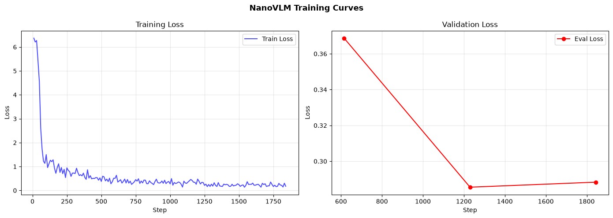

# NanoVLM: Medical VQA with Custom CUDA FlashAttention

A **research prototype** adapting [SmolVLM-500M-Instruct](https://huggingface.co/HuggingFaceTB/SmolVLM-500M-Instruct) to English-language visual question answering on [SLAKE](https://huggingface.co/datasets/mdwiratathya/SLAKE-vqa-english). Uses 4-bit QLoRA and a custom **Triton-JIT CUDA attention backend** (`nano_cuda_attn`) with tiled online-softmax forward and custom backward kernels.

> **Not intended for clinical diagnosis, patient care, or treatment decisions.** SLAKE VQA test accuracy does not establish diagnostic safety.

## Measured results (single local run)

| Metric | Value |
| --- | ---: |
| SLAKE test Exact Match (EM) | **74.55%** |
| SLAKE test token F1 | **78.64%** |
| SLAKE test-set examples evaluated | 1,061 |
| Peak PyTorch CUDA allocation during training | **4.471 GiB** |
| Sequential inference latency | **1,237.1 ms/image** |
| Sequential inference throughput | **0.81 images/s** |
| Total training runtime | **40,692.4 s (~11 h 18 min)** |
| Final epoch train loss / validation loss | 0.174018 / 0.288324 |
| Lowest epoch validation loss | **0.285518 (epoch 2)** |

**Provenance:** Values above are transcribed from the project author's notebook output on a single NVIDIA GeForce RTX 5070 Ti Laptop GPU under WSL Ubuntu. They have not been independently reproduced. They are not a controlled head-to-head comparison with published medical VLMs.



## Architecture

```text
SLAKE image + question
    -> SmolVLM image processor and chat template
    -> SmolVLM-500M-Instruct (4-bit NF4 QLoRA)
       - Vision attention  -> nano_cuda_attn (Triton CUDA)
       - Language attention -> nano_cuda_attn (Triton CUDA)
    -> generated answer
```

The attention kernels and gradients live in `nanoflash_cuda.py`. PyTorch SDPA is used only as a numerical correctness baseline in `test_nanoflash.py`; it is not a fallback during model training or inference. The backend name intentionally excludes the substring `flash` for compatibility with the Transformers attention registry.

## Hardware and environment

- Reference GPU: NVIDIA RTX 5070 Ti Laptop GPU
- OS: Ubuntu 26.04 LTS under WSL2
- Python: 3.12
- Measured runtime: PyTorch `2.14.1+cu130` (CUDA 13.0)
- Actual dependency versions should be recorded using `python -m pip freeze > environment_lock.txt` before publishing a reproducibility release.

Install a PyTorch CUDA build compatible with your GPU/driver first, then:

```bash
python -m pip install -r requirements.txt
python test_nanoflash.py
jupyter lab
```

Select the project `.venv` Jupyter kernel and open `NanoVLM_Custom_CUDA_FlashAttention_RTX5070Ti.ipynb` (or your corresponding locally saved notebook). Verify numerical parity, then run the notebook cells in order. Training on new hardware may require modifying the batch size and mixed-precision settings.

## Outputs

The notebook writes the LoRA adapter and processor to `nanovlm-medic-adapter/` using `save_pretrained()`. This folder is intentionally ignored by Git and should be published separately in a **Hugging Face model repository**, while the source code and tests belong on GitHub.

**Hugging Face adapter:** insert your final link once published.

**GitHub source:** insert your final link once published.

Read [PUBLISHING.md](PUBLISHING.md) for a safe release process and `HF_MODEL_CARD.md` for the model card used by `scripts/publish_hf.py`.

## Evaluation and limitations

- Test metrics: answer Exact Match and token F1 from a single run; evaluation details must match the notebook before comparing with external results.
- Loss over epochs: validation loss improved through epoch 2, then increased slightly in epoch 3. If `load_best_model_at_end=True` was in effect, the saved adapter may represent the best-validation checkpoint rather than the final epoch.
- `CALLS` showed custom attention execution in both towers, but does **not** establish speedup over optimized SDPA.
- Many FP32 to BF16/FP16 casts occurred. Quantify numerical and runtime overhead separately.
- CUDA memory measured via `torch.cuda.max_memory_allocated()` excludes some process and driver allocations; it is not a total system-memory figure.
- No SLAKE result alone validates real-world medical diagnosis or performance on other datasets.
- Current kernel does not support every attention shape, dropout mode, or hardware backend. Confirm numerical parity and gradient correctness before reusing it elsewhere.

## Upstream acknowledgements

- [HuggingFaceTB/SmolVLM-500M-Instruct](https://huggingface.co/HuggingFaceTB/SmolVLM-500M-Instruct)
- [SLAKE English VQA dataset mirror](https://huggingface.co/datasets/mdwiratathya/SLAKE-vqa-english)
- [Hugging Face Transformers](https://github.com/huggingface/transformers), [PEFT](https://github.com/huggingface/peft), [Triton](https://github.com/triton-lang/triton)

Before adding a software license, verify that all incorporated third-party code and data can be redistributed under that license; the base model and dataset remain separately attributed.
